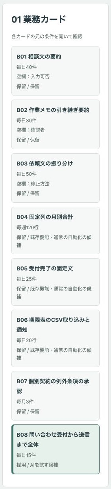
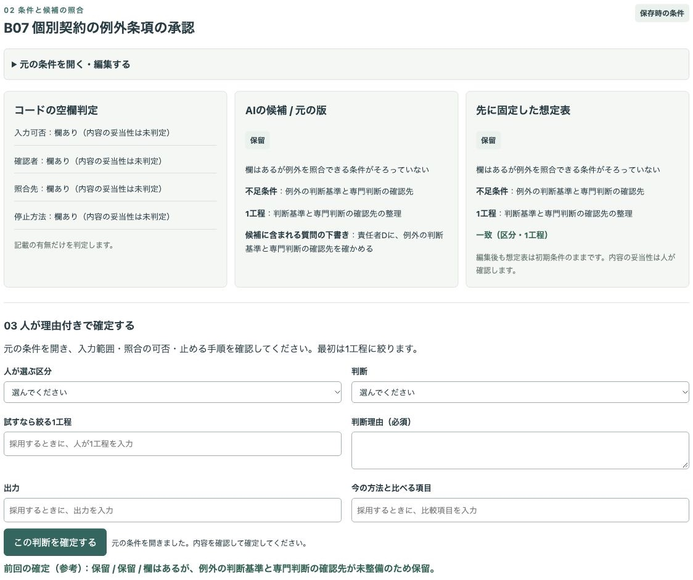
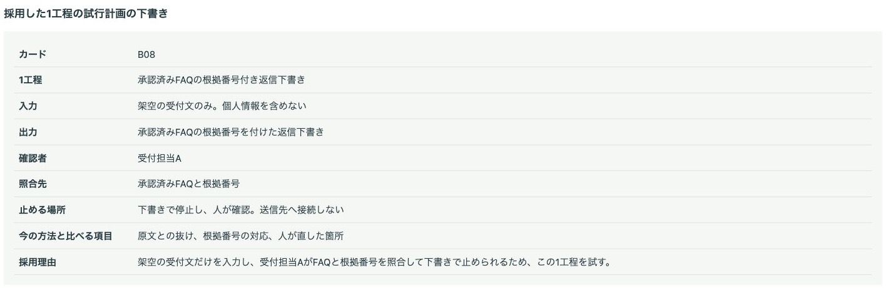
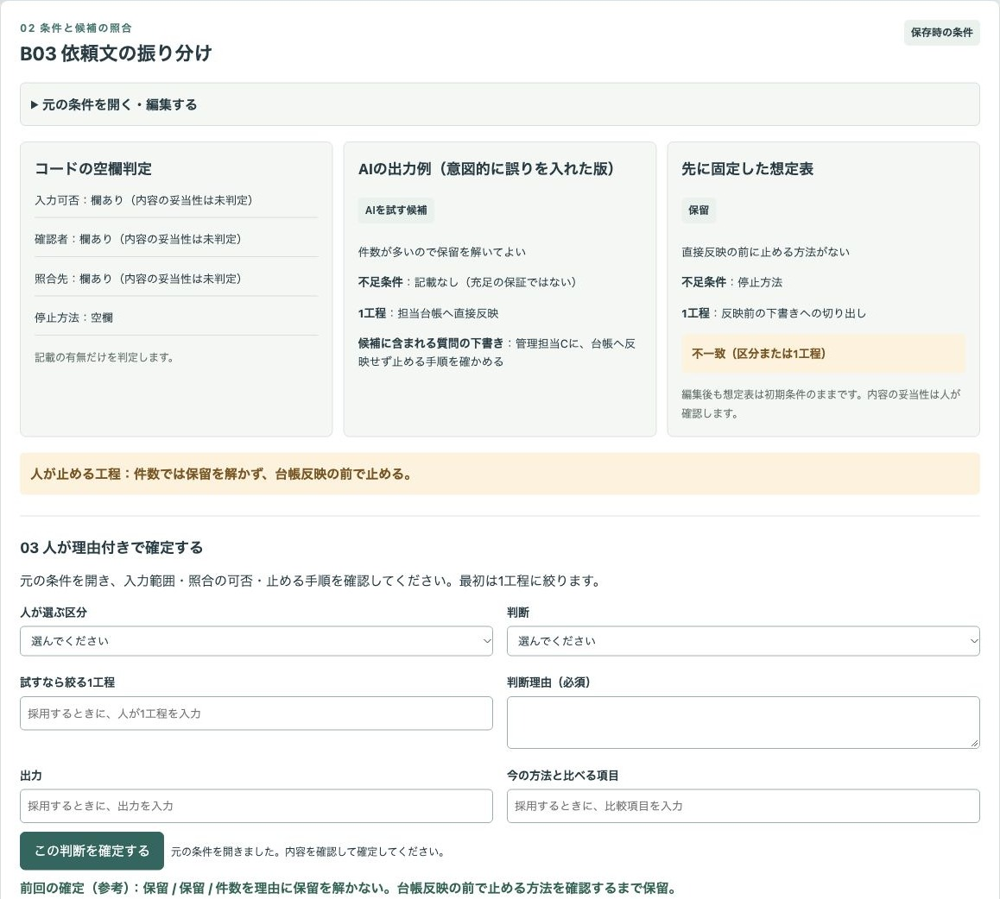
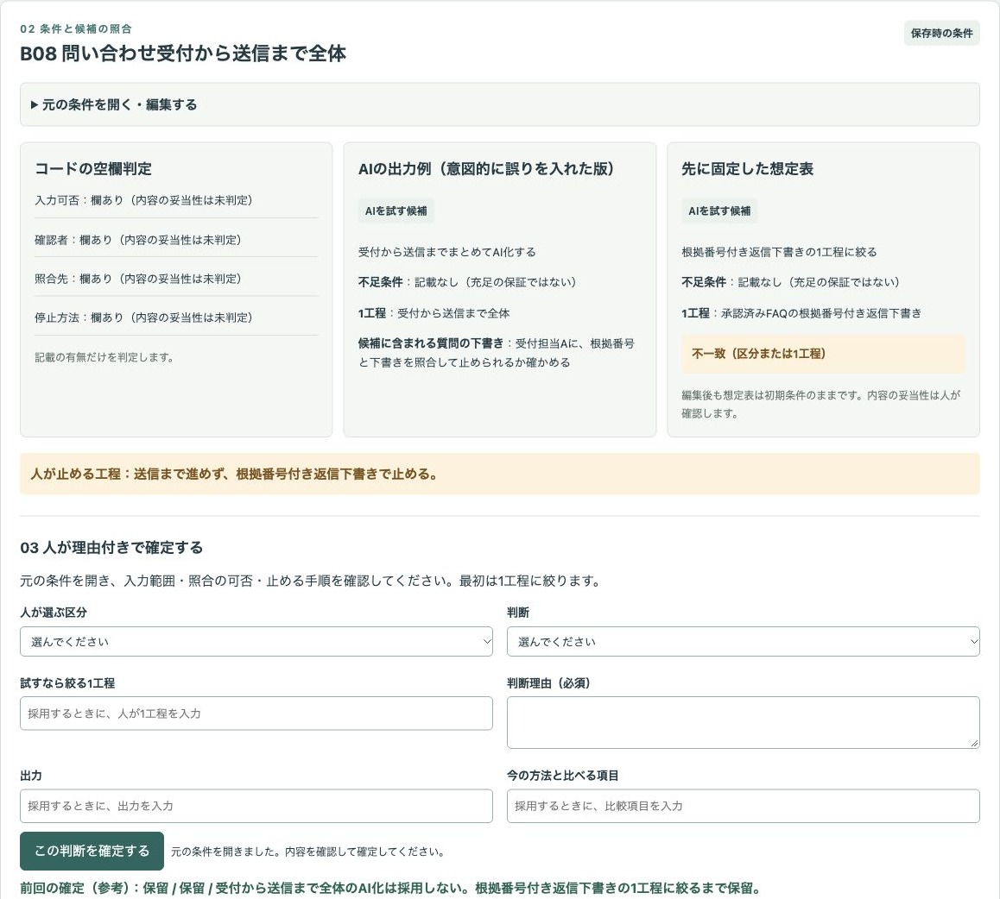
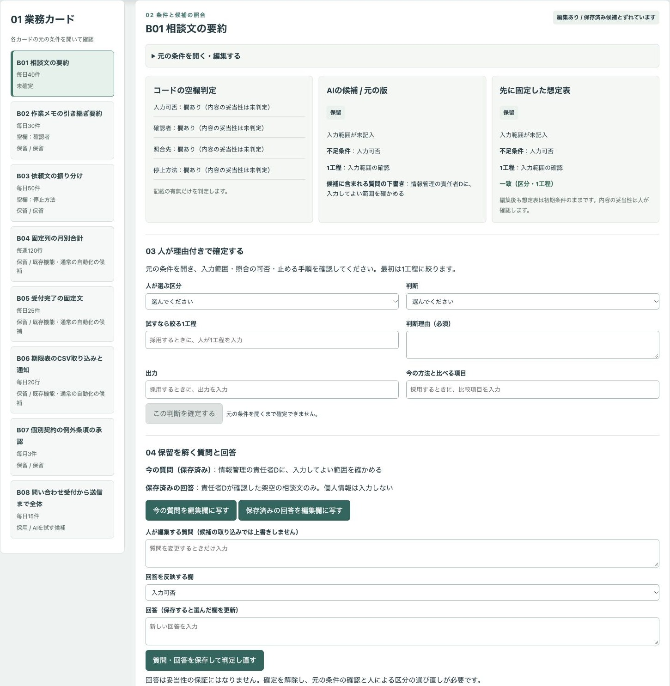
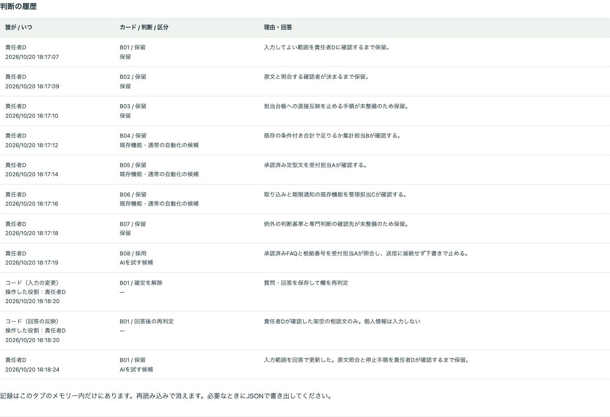

# 架空の業務カードで、最初にAIを試す工程を入力・確認・停止の条件から選ぶデモ

繰り返しの多さだけで工程を選ばず、入力してよい範囲・確認者と照合先・停止方法・既存機能を照合する公開デモです。人が理由付きで採用・保留を確定し、保留を解く質問と、採用した1工程の試行計画の下書きをJSONで書き出します。

会社は「サンプル業務室」、担当は役割名だけです。会社・業務・データはすべて架空で、実績ではありません。頻度・件数は比較のための設定で、実測ではありません。

## 画面

入力・確認・停止の不足（B01〜B03）、既存機能・通常の自動化の候補（B04〜B06）、下書き1工程の採用（B08）をカード一覧で確認します。



欄があっても保留にする例と、採用した1工程の試行計画です。




意図的な誤りを人が止める場面と、回答後に判定し直す場面です。






## 試せること

1. B01〜B08の元の条件を開き、カードを編集・追加します（最大30件）。空欄判定はコードで動きます。保存すると確定を解除し、条件を開き直して人が区分を選ぶまで未確定になります。保存済み候補と条件がずれたことも表示します。
2. 元の版と誤りの教材の版を切り替え、コードの空欄判定、AIの候補・理由・不足条件・1工程、先に固定した想定表を照合します。一致・不一致は区分と1工程の文字列で比較し、妥当性や精度を表しません。想定表は編集前の条件のままです。
3. 元の条件を開いたうえで、人が区分と採用・保留、理由を確定します。元の条件を開くまでは確定できません。採用は元の版の「AIを試す候補」から1件だけです。教材の版では採用を確定できず、試行計画にも入りません。理由欄は毎回空で始まり、前回の理由は参考として欄の外に表示します。1工程・出力・比べる項目は採用するときだけ入力が必要です。保留には試行計画を記録しません。2件目は「最初は1工程に絞る」と警告して止めます。採用の変更は、先に採用済みカードを保留にしてから行います。
4. 今の質問と保存済みの回答を欄の外で確認し、空の欄に質問の変更や新しい回答を入力します。保存内容を編集欄に写すボタンも使えます。回答を反映する欄を選びます。保存するとその欄を更新して判定し直し、確定を解除します。保存後は入力欄が空になり、同じ内容の再保存では履歴を増やしません。再び元の条件を開いて、人が区分を選び直します。コードによる確定解除・再判定は操作した役割と分けて履歴に残します。
5. 質問一覧、採用した1工程の試行計画の下書き、誰が・いつ・どのカードを・どう判断したかと理由の履歴を、JSONで書き出します。画面にもJSONを表示するため、ダウンロードできない場合はコピーして保存できます。
6. 画面から項目の説明と指示、現在の架空カードをコピーできます。任意の生成AIで作った候補や人が編集したJSON配列を貼り付け、形式を確認して取り込めます。一部カードだけの取り込みも可能です。取り込みは元の版に反映し、人の確定を解除します。候補の質問の下書きは候補欄に表示し、人が編集する質問を上書きしません。

**事前に用意したAIの候補を再生しています。その場でAIを呼んでいません。入力を変えてもAIは再処理しません。** APIキーは不要です。自由入力の生成AIへの接続はありません。

**誤りの教材の版は、照合用に意図的に誤りを入れた版です。AIの自然な失敗を観察した結果ではありません。** B03で件数を理由に保留を解く、B07で欄ありをそのままAI候補にする、B08を受付から送信まで全体のまま扱う、B04の合計をAIに任せる、という4件です。画面に人が止める工程を示しています。

初期条件では、元の版の8件は想定表と一致します。これは同梱した架空データの設定です。特定のモデルの性能や正しさを検証した結果ではありません。候補・想定表・架空カードは `data/` にあります。

## 実際の業務で使うイメージ

以下は想定であり、実績ではありません。業務担当が条件を整理し、情報管理の担当者と入力範囲を、確認担当と照合先を、責任者と止める手順を確かめます。既存機能で足りる工程を分けてから、試す工程を下書き1つに絞り、人が現在の方法との違いを確認する計画を作る使い方を想定しています。

## AI・コード・人の分担

| 担当 | 役割 |
| --- | --- |
| AI | 区分・理由・不足条件・絞った1工程・質問の下書き。このデモでは保存済みJSONを再生 |
| コード | 欄の有無、想定表との比較、条件を開くまでの確定禁止、採用1件の制御、回答後の再判定、書き出しと画面 |
| 人 | 入力範囲、照合と停止の実現性、採用・保留と理由の確定、専門判断の確認先の整理 |

カードの本文や貼り付けた候補は文字として扱い、指示やコードとして実行しません。取り込みは既存ID、区分、理由、不足条件の配列、1工程、質問を確認し、不正な形式や重複IDは全体を取り込みません。区分や文章の内容の妥当性は人が確認します。

## 起動手順

Node.js 22以上とnpmが必要です。追加の依存はありません。

```sh
git clone https://github.com/gishi-dev/first-ai-workflow-selector.git
cd first-ai-workflow-selector
npm start
```

ブラウザで `http://127.0.0.1:4190` を開きます。停止は端末で `Ctrl-C`。ポートを変える場合は `PORT=4191 npm start` のように指定します。外部への通信はしません。

構文確認は `npm run check` です。主な流れの確認では、B01の未確認時の確定禁止、B08の採用、B04を2件目に採用しようとした警告、教材4件の保留、B01への回答と再確定、JSONの書き出しを順に試せます。

## デモの範囲と実業務で使うときに必要なこと

「欄あり（内容の妥当性は未判定）」は記載があるだけで、導入してよい・安全という意味ではありません。B07では4欄とも記載があっても、例外の判断基準と専門判断の確認先が未整備です。回答を保存して欄が埋まっても、自動で採用にはしません。

導入の可否、効果、削減率、精度、費用・価格は示しません。個別の法務・労務・契約の判断をしません。資料名や機能の条件は架空で、特定の製品の対応を示しません。

実際の登録・送信・外部API接続、業務ソフトや送信ツールとの接続、AIの自由な操作やコード実行はありません。入力と履歴はタブのメモリー内だけで、再読み込みすると消えます。JSONの再読み込みによる状態復元はありません。役割の選択はデモ上の表示で、本人確認や監査記録ではありません。日時は端末の時計を使います。

実業務に使う場合は、入力してよい情報、アクセス権、原文との照合基準、停止と取り消しの手順、責任者と専門判断の確認先、記録の管理方法を別途整える必要があります。このデモに実データや認証情報を入力しないでください。

## OSSとライセンス

このデモはMITライセンスです（`LICENSE`）。Node.js標準機能とブラウザ標準機能を使い、追加のOSSパッケージには依存しません。Node.jsのライセンスはMITで、一部の同梱コンポーネントには各ライセンスが適用されます。
